# ROUND 12 — Documento de Diseño del Videojuego (GDD)

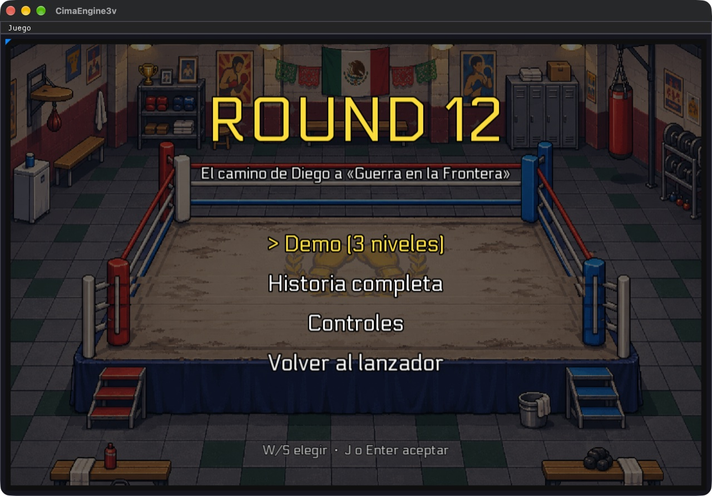

| | |
|---|---|
| **Proyecto** | ROUND 12 — *El camino de Diego a «Guerra en la Frontera»* |
| **Autor** | Carlos Ariel Ureta Armenta — 2208511 |
| **Asignatura** | Introducción a los Videojuegos, grupo 351 |
| **Institución** | Universidad Autónoma de Baja California, Facultad de Ciencias Químicas e Ingeniería |
| **Docente** | Gustavo Omar Zamarrón De La Garza |
| **Motor** | CimaEngine3v (C++17, SFML 3, Dear ImGui) |
| **Versión del documento** | 1.0 — GDD completo (consolida los avances 1 a 4 y el estado actual del código) |
| **Fecha** | 25 de noviembre de 2026 |

---

## Índice

1. [Descripción del proyecto](#1-descripción-del-proyecto)
2. [Personajes](#2-personajes)
3. [Historia](#3-historia)
4. [Tema y ambientación](#4-tema-y-ambientación)
5. [Estilo gráfico y arte](#5-estilo-gráfico-y-arte)
6. [Música y sonidos](#6-música-y-sonidos)
7. [Interfaz de usuario](#7-interfaz-de-usuario)
8. [Controles](#8-controles)
9. [Progresión](#9-progresión)
10. [Niveles y entornos](#10-niveles-y-entornos)
11. [Gameplay](#11-gameplay)
12. [Metas](#12-metas)
13. [Mecánicas](#13-mecánicas)
14. [Habilidades](#14-habilidades)
15. [Ítems y power-ups](#15-ítems-y-power-ups)
16. [Dificultad](#16-dificultad)
17. [Accesibilidad](#17-accesibilidad)
18. [Marketing](#18-marketing)
19. [Audiencia](#19-audiencia)
20. [Plataformas y requisitos técnicos](#20-plataformas-y-requisitos-técnicos)
21. [Monetización](#21-monetización)
22. [Arquitectura técnica](#22-arquitectura-técnica)
23. [Pruebas y herramientas de desarrollo](#23-pruebas-y-herramientas-de-desarrollo)
24. [Cambios respecto al Avance 4 y pendientes](#24-cambios-respecto-al-avance-4-y-pendientes)
25. [Conclusión](#25-conclusión)
26. [Referencias](#26-referencias)
27. [Anexo: catálogo de recursos](#27-anexo-catálogo-de-recursos)

---

## 1. Descripción del proyecto

### 1.1 Concepto

ROUND 12 es un videojuego deportivo de boxeo en 2D para un jugador. Narra el ascenso de **Diego Alejandro Ureta**, un niño tijuanense de 12 años que sueña con ser campeón, desde su primer día en el gimnasio hasta el torneo internacional juvenil **«Guerra en la Frontera»**. El juego alterna combates uno contra uno en el ring con sesiones de entrenamiento jugables en escenarios reconocibles de Baja California.

La experiencia combina la sencillez de los juegos arcade clásicos con un **sistema de estadísticas físicas** —resistencia, aire, sed y concentración— que obliga al jugador a administrar el cuerpo del boxeador y no solo a presionar botones.

La historia ocurre en 2024, pero el apartado audiovisual es un homenaje a los años 80: pixel art, animaciones cuadro por cuadro, música en formato chiptune y cinemáticas sin voces con diálogos en cuadros de texto.

### 1.2 Ficha técnica

| Elemento | Especificación |
|---|---|
| Título | ROUND 12 |
| Género | Deportivo / peleas (boxeo) con progresión y entrenamiento |
| Modos | Un jugador: **Demo** (3 niveles) e **Historia completa** |
| Perspectiva | 2D; ring y gimnasios en vista 3/4 pintada; carreras en vista lateral; zona final de la playa en vista isométrica |
| Plataforma | PC (Windows, Linux y macOS), solo teclado |
| Resolución | Ventana lógica de 1080 × 720 px; decorados pintados a 1920 × 1080 px escalados sin suavizado |
| Estilo visual | Pixel art retro inspirado en los años 80 |
| Audio | Música chiptune en bucle por escena y efectos de sonido; sin voces |
| Idioma | Español (textos, menús y subtítulos) |
| Clasificación estimada | E (Everyone): violencia deportiva sin sangre ni lenguaje ofensivo |
| Duración | Demo: 15–20 min. Historia completa: 60–90 min aproximados |

### 1.3 Pilares de diseño

1. **El cuerpo es el recurso.** Cada golpe gasta aire y genera sed; quien golpea sin control se queda expuesto.
2. **Entrenar sirve.** Cada estación, carrera y sparring mejora atributos visibles en la pantalla de resultados.
3. **Aprender de la derrota.** La semifinal contra Ricardo está diseñada para perderse; la segunda mitad del juego es la respuesta.
4. **Identidad regional.** Tijuana, Rosarito y Mexicali representados con su cultura boxística fronteriza.

### 1.4 Elementos principales

- Combates 1 contra 1 con cuatro golpes, guardia, esquivas laterales, agacharse, combinaciones y contragolpes.
- Estaciones de entrenamiento jugables: costal, manoplas (ritmo) y cuerda (pulso musical).
- Carreras de resistencia en la playa de Rosarito y en el circuito atlético.
- Fases de pelea completas: presentación, round, caída y conteo, esquina, decisión de jueces.
- Cinemáticas con retratos y diálogos en subtítulos.
- Progresión por etapas: sparrings, torneos locales, «Guerra en la Frontera», revanchas y final a 12 rounds.

---

## 2. Personajes

### 2.1 Sistema de atributos

Cada boxeador tiene **siete atributos** en escala del 1 al 10. Los cuatro primeros alimentan las barras físicas del GDD; los tres últimos son de combate. Los atributos de Diego aumentan con el entrenamiento y nunca salen del rango 1–10.

| Atributo | Efecto en el juego |
|---|---|
| Resistencia | Tamaño de la barra de resistencia (`40 + 8 × resistencia`). |
| Aire | Costo de golpes y esquivas (más aire = golpes más baratos) y recuperación por segundo. |
| Sed (tolerancia) | Qué tan rápido sube la sed por tiempo y por golpe. |
| Concentración | Valor inicial de la barra de concentración (`50 + 5 × concentración`) y pérdida por golpes a la cabeza. |
| Velocidad | Velocidad de desplazamiento (`30 + 3 × velocidad`) y de animación de golpes. |
| Defensa | Reducción del daño al bloquear (`7 %` por punto). |
| Poder | Multiplicador del daño base (`0.5 + 0.1 × poder`). |

### 2.2 Tabla comparativa de atributos iniciales

| Atributo | Diego | Brandon | Javier | Kevin | Ricardo | Niño del barrio |
|---|:-:|:-:|:-:|:-:|:-:|:-:|
| Resistencia | 6 | 7 | 7 | 5 | 9 | 3 |
| Aire | 7 | 5 | 5 | 8 | 9 | 3 |
| Sed (tolerancia) | 6 | 6 | 5 | 7 | 8 | 3 |
| Concentración | 7 | 5 | 4 | 7 | 9 | 3 |
| Velocidad | 7 | 5 | 4 | 9 | 8 | 3 |
| Defensa | 5 | 6 | 5 | 6 | 9 | 3 |
| Poder | 8 | 5 | 9 | 5 | 9 | 3 |

> El atributo *poder* no figuraba en la tabla del Avance 4; su valor se definió según el estilo de pelea descrito para cada boxeador.

### 2.3 Formato de los sprites

Todos los personajes comparten el mismo formato de animación:

- Cuadros RGBA de **80 × 80 px** con ancla común en `(40, 70)` (pies del personaje).
- **Cuatro direcciones**: adelante, atrás, derecha e izquierda (la izquierda es el espejo de la derecha).
- **39 acciones** de 6 cuadros cada una: `idle`, `caminar`, `guardia`, `jab`, `recto`, `gancho`, `uppercut`, `esquiva_izquierda`, `esquiva_derecha`, `agacharse`, `saltar`, `recibir_golpe`, `caer`, `levantarse` y sus combinaciones (por ejemplo `caminar_jab`, `agacharse_uppercut`, `saltar_gancho`, `esquiva_derecha_recto`).
- Hoja empacada por personaje de **1920 × 3120 px**: columna = `dirección × 6 + cuadro`, fila = acción.
- **8 retratos** de 96 × 96 px por emoción para el HUD: neutral, hablando, decidido, sorprendido, sonriendo, celebrando, cansado y escuchando.
- Hoja de **animación hablando** de 1280 × 640 px: cuerpo completo en 4 direcciones × 4 cuadros por cada una de las 8 emociones, para las conversaciones dentro del escenario.
- **Rostros de diálogo** (Diego y Carlos): busto en 5 vistas (frente, tres cuartos y perfil a cada lado) con 6 expresiones (neutral, serio, sonriendo, sorprendido, boca abierta y boca cerrada) para el cuadro de diálogo.

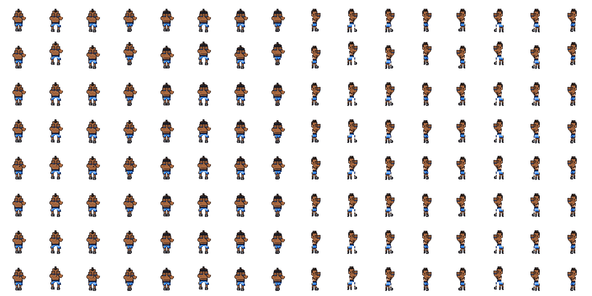

*Figura 2.0. Hoja de animación hablando (ejemplo: Javier). Columnas: dirección × cuadro; filas: emoción.*

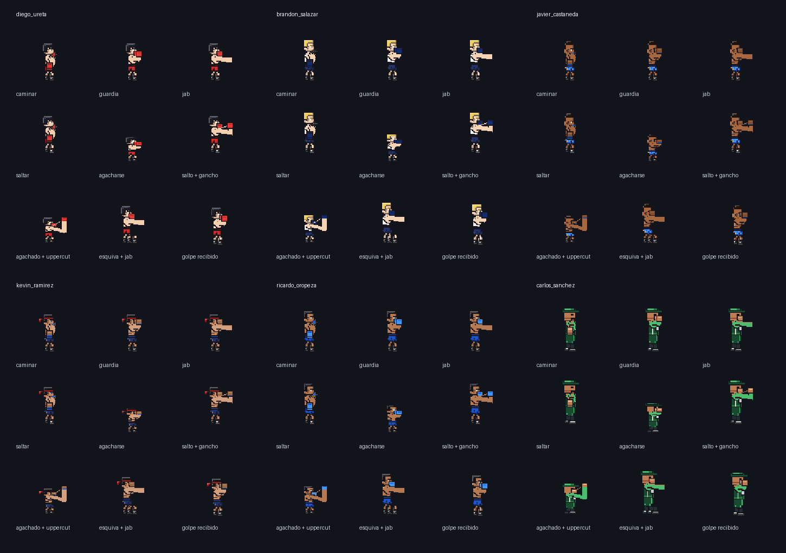

*Figura 2.1. Muestra de movimientos de los seis personajes: caminar, guardia, jab, saltar, agacharse, salto con gancho, uppercut agachado, esquiva con jab y golpe recibido.*

### 2.4 Diego Alejandro Ureta — protagonista

| Retrato | Datos |
|---|---|
|  | **Edad:** 12 años · **Origen:** Tijuana · **Estilo:** agresivo, mucho poder para su tamaño · **Golpe característico:** gancho de izquierda · **Especial:** combinación «Frontera» (1-2-3-4) |

**Backstory.** Diego vive en Tijuana con sus papás. Desde pequeño veía peleas de box en la televisión con su familia, y el anime *Hajime no Ippo* terminó de convencerlo: quiere subirse a un ring. En 2024 convence a sus padres de inscribirlo en el Sanchez Boxing GYM, el mismo gimnasio donde entrenó su hermano mayor. Ahí descubre que tiene una fuerza y una disciplina poco comunes para su edad. Es terco, competitivo y nunca falta a un entrenamiento, pero su confianza lo hace descuidar la defensa, un defecto que pagará caro en la semifinal.

**Prototipo visual.** Niño delgado pero firme, piel clara, cabello negro y lacio con fleco, short rojo, guantes rojos y botas negras.

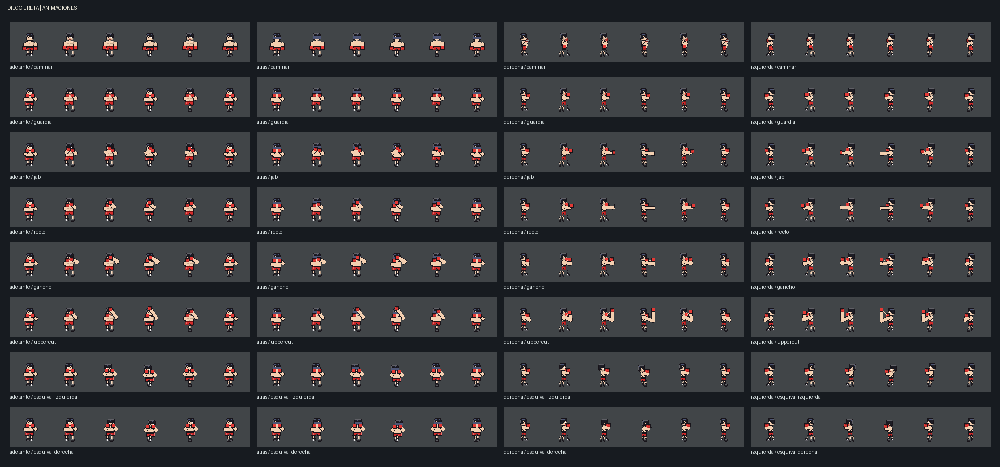

*Figura 2.2. Hoja de animaciones de Diego en las cuatro direcciones.*

**Emociones del retrato en el HUD:**

| Cansado | Celebrando | Decidido | Escuchando | Hablando | Sonriendo | Sorprendido |
|:-:|:-:|:-:|:-:|:-:|:-:|:-:|
| 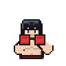 | 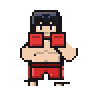 | 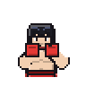 |  |  |  | 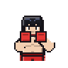 |

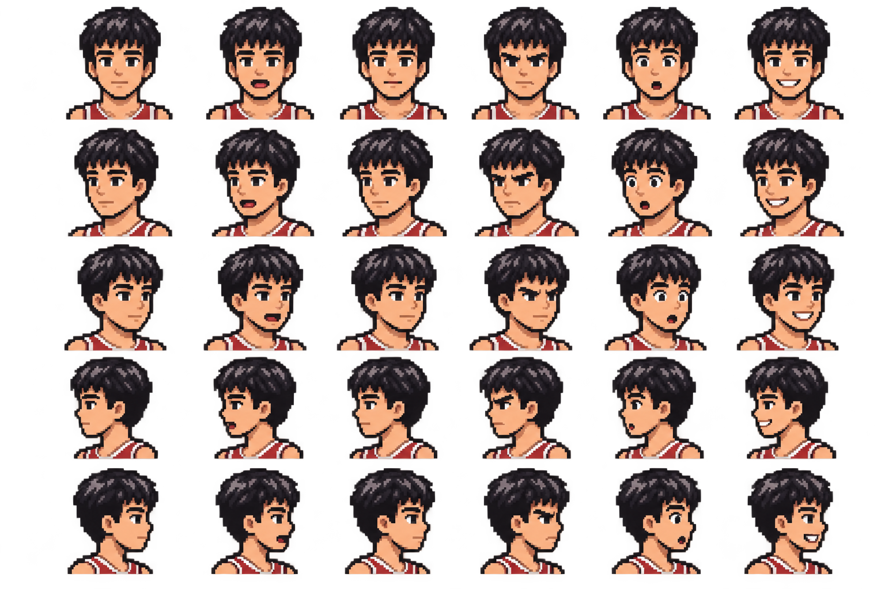

*Figura 2.3. Rostros de diálogo de Diego: 5 vistas (filas) × 6 expresiones (columnas).*

### 2.5 Carlos Sánchez — entrenador (NPC)

| Retrato | Datos |
|---|---|
| 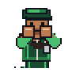 | **Edad:** ~45 años · **Rol:** entrenador, guía y narrador de tutoriales · **No combate** |

**Backstory.** Exboxeador tijuanense que se retiró joven por una lesión y fundó el Sanchez Boxing GYM, un gimnasio verde y negro donde ha formado a varias generaciones de peleadores del barrio. Es exigente, de pocas palabras y muy protector con sus alumnos. Ve en Diego un talento especial y decide acelerar su progreso.

**Rol en el juego.** Explica los controles, sostiene las manoplas, camina a la esquina de Diego entre rounds, da consejos que suben la concentración y aparece en la mayoría de las cinemáticas. Sus animaciones de golpes son demostraciones de entrenamiento sin guantes.

**Prototipo visual.** Bigote, gorra y pants deportivos verdes con franjas negras, toalla al hombro y cronómetro al cuello.

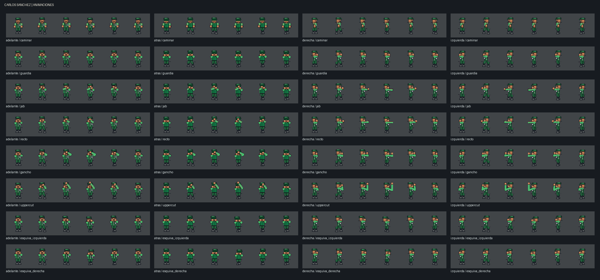

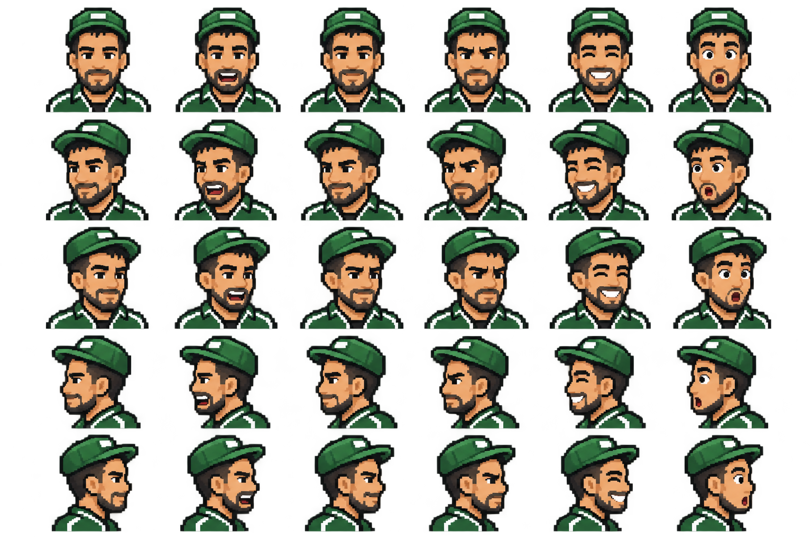

*Figura 2.4. Rostros de diálogo de Carlos.*

### 2.6 Rivales

Los rivales aparecen en orden de dificultad. Cada uno tiene un **estilo de IA** distinto definido por cinco parámetros: probabilidad de guardia, probabilidad de esquiva, distancia ideal (px de arte), agresividad y pesos de elección de golpe (jab / recto / gancho / uppercut).

| Rival | Guardia | Esquiva | Distancia | Agresividad | Pesos J / R / G / U |
|---|:-:|:-:|:-:|:-:|:-:|
| Brandon | 0.60 | 0.10 | 32 | 0.4 | 0.70 / 0.20 / 0.05 / 0.05 |
| Javier | 0.10 | 0.05 | 20 | 0.9 | 0.15 / 0.15 / 0.50 / 0.20 |
| Kevin | 0.20 | 0.35 | 36 | 0.5 | 0.40 / 0.40 / 0.10 / 0.10 |
| Ricardo | 0.35 | 0.40 | 28 | 0.7 | 0.40 / 0.25 / 0.20 / 0.15 |
| Niño del barrio | 0.20 | 0.05 | 26 | 0.4 | 0.40 / 0.30 / 0.20 / 0.10 |

#### Brandon «El Güero» Salazar — rival de sparring

| Retrato | Datos |
|---|---|
| 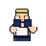 | **Edad:** 15 años · **Escuela:** primero de preparatoria · **Estilo:** defensivo, guardia alta y jab constante |

**Backstory.** Alumno veterano del Sanchez Boxing GYM, acostumbrado a ser el más fuerte del lugar. Al principio se burla de que el entrenador lo ponga a hacer sparring con un niño de primaria; tras varias sesiones reconoce el talento de Diego y se convierte en su compañero de entrenamiento.

**Función de diseño.** Rival tutorial: enseña a no gastar todo el aire contra un oponente que se cubre y a usar la esquiva.

**Prototipo visual.** Adolescente alto, cabello rubio corto, playera blanca sin mangas, short azul marino y guantes negros.

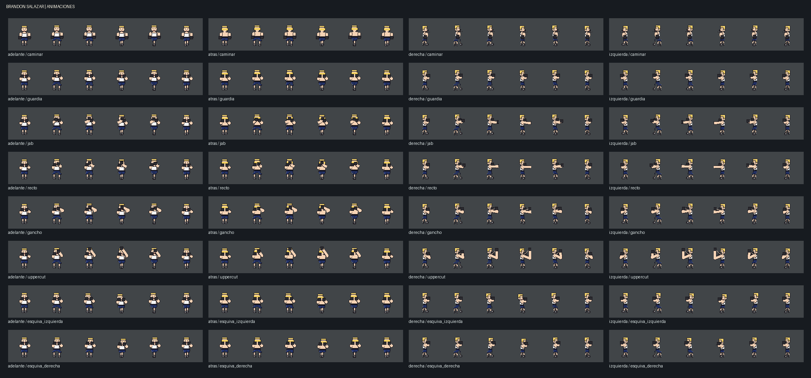

#### Javier «El Toro» Castañeda — primer rival del torneo

| Retrato | Datos |
|---|---|
| 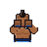 | **Edad:** 13 años · **Origen:** Ensenada · **Estilo:** fajador, ganchos muy potentes |

**Backstory.** Hijo de una familia de pescadores, entrena en un gimnasio pequeño junto al puerto. Llega al torneo con fama de noqueador y un carácter impulsivo.

**Función de diseño.** Avanza sin parar y lanza ganchos, pero tiene poco aire: cuando su aire baja de 30 su agresividad cae a 0.3. Esquivarlo y cansarlo es la clave.

**Prototipo visual.** Cabello en cresta, piel morena, short naranja y guantes azules.

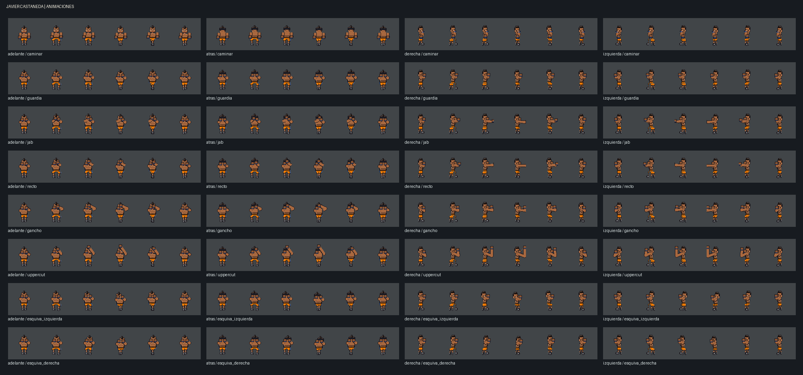

#### Kevin «The Hawk» Ramírez — segundo rival del torneo

| Retrato | Datos |
|---|---|
| 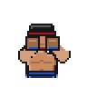 | **Edad:** 13 años · **Origen:** Calexico, California · **Estilo:** estilista, golpea y se aleja |

**Backstory.** Boxeador méxico-estadounidense que cruza la frontera para competir en Mexicali; representa el carácter internacional del torneo. Es disciplinado, analítico y el más veloz de los rivales.

**Función de diseño.** Obliga a usar la concentración para anticipar sus ataques y a cortar el ring.

**Prototipo visual.** Banda roja en la frente, guantes blancos, short azul marino y botas negras.

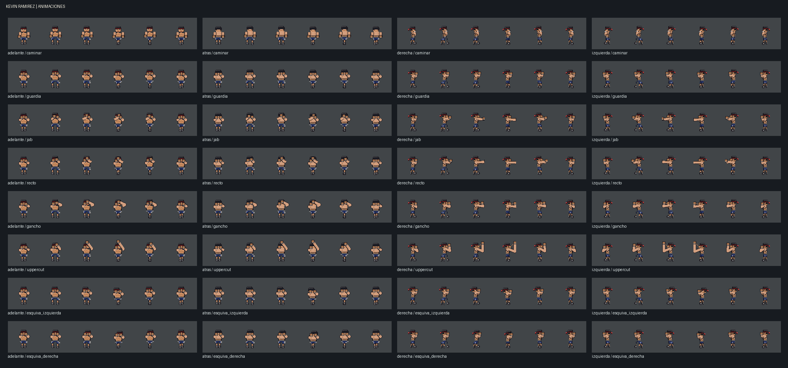

#### Ricardo Oropeza — rival final (jefe)

| Retrato | Datos |
|---|---|
| 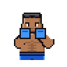 | **Edad:** 14 años · **Origen:** Mexicali (pelea en casa) · **Logro:** campeón nacional de su rango de edad · **Estilo:** completo |

**Backstory.** Dos años mayor que Diego, serio, técnico y sumamente disciplinado. Nunca se sale del reglamento, pero tampoco muestra piedad arriba del ring.

**Función de diseño.** Combina presión, contragolpes y un jab que mantiene la distancia. En la semifinal vence a Diego por decisión unánime de forma obligatoria; en la final es el combate más largo del juego (12 rounds).

**Prototipo visual.** Adolescente alto y musculoso, cabello negro corto, short con cintura dorada y guantes de campeón.

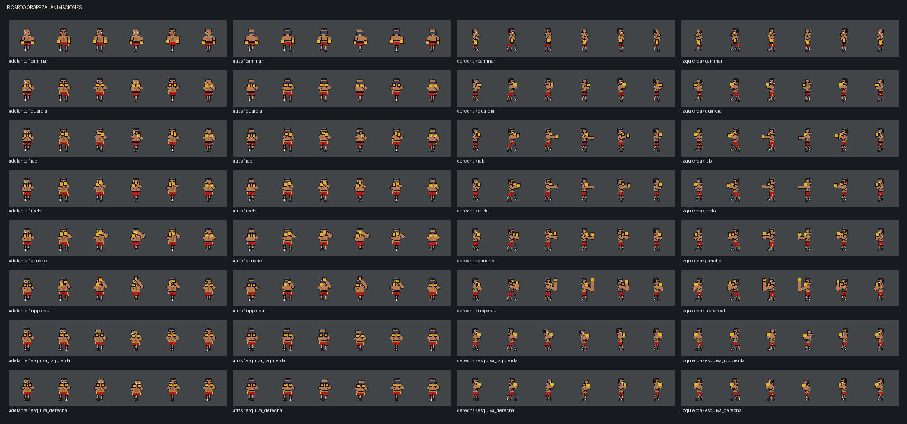

#### Niño del barrio

Rival genérico de los sparrings infantiles y los torneos locales. Reutiliza el sprite de Diego con un **tinte de piel** distinto. En los torneos locales sus atributos se sortean entre 4 y 6.

---

## 3. Historia

### Prólogo: el sueño

Tijuana, 2024. Diego Alejandro Ureta tiene doce años y una idea fija que crece cada vez que ve *Hajime no Ippo*: quiere entrenar box. Después de semanas de insistir, sus papás lo llevan al Sanchez Boxing GYM, el gimnasio donde años atrás entrenó su hermano mayor.

Lo recibe Carlos Sánchez, con su cronómetro colgado al cuello y una sola regla: *«Aquí nadie pelea hasta que aprende a entrenar»*. Diego no lo piensa dos veces. Empieza por el costal, sigue con las manoplas y termina saltando la cuerda, mientras el entrenador le repite lo único que importa: sin aire no hay golpes.

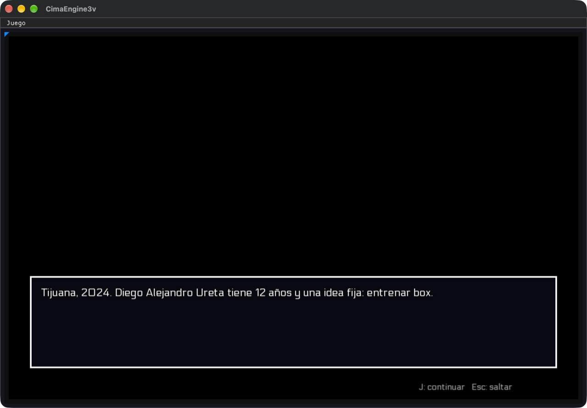

### Capítulo 1: seis meses de sudor

Durante seis meses Diego no falta un solo día. Entre semana suda en el gimnasio; los fines de semana corre por la arena de la playa de Rosarito hasta el muelle y da vueltas al circuito atlético contra el reloj. Cada carrera lo deja sin aliento, pero cada semana llega un poco más lejos.

Al terminar ese periodo se arma de valor y le pide a Carlos una oportunidad. El entrenador lo pone a hacer sparring con niños de su edad, y pronto resulta evidente que Diego es más fuerte que todos ellos.

### Capítulo 2: más fuerte que los demás

Carlos toma una decisión arriesgada: enfrentarlo con adolescentes. Brandon «El Güero» Salazar, de primero de preparatoria, se ríe al ver que le ponen enfrente a un niño de primaria. Tres rounds después ya no se ríe. Diego resiste, aprende a esquivar y descubre que un golpe justo después de una esquiva pega el doble.

Con esa confianza llegan los torneos locales en gimnasios de otras ciudades. Diego destaca con facilidad frente a rivales de su edad y peso, así que Carlos y sus papás deciden inscribirlo en una categoría superior, en el torneo más importante de la región.

### Capítulo 3: Guerra en la Frontera

«Guerra en la Frontera» es un torneo internacional con sede en el Gimnasio de Box de Mexicali, al que llegan jóvenes de todo Baja California y del sur de Estados Unidos. Hay gradas llenas, banderas de México y Estados Unidos y luces blancas sobre el ring.

En el vestidor, Carlos le venda las manos sin prisa mientras el ruido del público se cuela por el pasillo. En la primera pelea, Javier «El Toro» Castañeda llega desde Ensenada presumiendo que nadie le aguanta dos rounds; Diego resiste sus ganchos, lo cansa y lo supera. En la segunda, Kevin «The Hawk» Ramírez, el estilista veloz de Calexico, lo obliga a una pelea cerradísima. Diego también la gana, y llega a la semifinal convencido de que nadie puede detenerlo.

### Capítulo 4: la semifinal

Lo espera Ricardo Oropeza, campeón nacional de su edad, dos años mayor y peleando ante su propio público. Desde la primera campana la diferencia es clara: Ricardo controla la distancia, anula el gancho de Diego y castiga cada descuido en su defensa. No hay nocaut ni polémica; todo ocurre conforme al reglamento. Los tres jueces ven ganar a Ricardo.

El castigo, sin embargo, es devastador. Diego queda en un estado de inconsciencia y trauma que se prolonga durante treinta horas. Mientras tanto, Ricardo avanza a la final y se proclama campeón.

> **Diseño:** esta pelea no se puede ganar. Su objetivo narrativo es mostrar que el talento no basta sin defensa, estrategia y disciplina.

### Epílogo: rumbo al round 12

Diego despierta en el hospital con sus papás y con Carlos a su lado. El entrenador le dice algo que no va a olvidar: *los campeones no se definen en el primer round, sino en el último, cuando ya no queda aire y solo sigue de pie quien se preparó para llegar ahí.* Diego responde con una promesa: el próximo año, el campeón va a ser él.

### Segunda mitad: el año de la revancha

Viene un año de entrenamiento más exigente. La playa y el circuito, otra vez, ahora con menos tiempo. Javier y Kevin también entrenaron, y las revanchas en Mexicali son más duras que las primeras peleas.

Un año después, en la final de «Guerra en la Frontera», Ricardo lo espera de nuevo. *«Creciste, Diego. Pero esto dura doce rounds.»* —*«Por eso entrené. Para seguir de pie en el último.»* Al final, Diego Alejandro Ureta llega de pie al round final y se corona campeón de su categoría.

---

## 4. Tema y ambientación

- **Tema central:** perseverancia, superación después de la derrota y la relación maestro–alumno.
- **Contexto:** boxeo amateur juvenil del noroeste de México: gimnasios de barrio, sparrings, entrenamientos al aire libre y torneos.
- **Lugares:** Tijuana (Sanchez Boxing GYM), Rosarito (playa y circuito atlético), gimnasios visitantes de la región y Mexicali (sede del torneo).
- **Época:** 2024, representado con la estética de los videojuegos de los años 80.
- **Cultura fronteriza:** convivencia de peleadores mexicanos y estadounidenses; papel picado, banderas de México y Estados Unidos y mantas del torneo en los decorados.
- **Tono:** optimista y deportivo, sin violencia gráfica; la derrota se presenta como aprendizaje.

---

## 5. Estilo gráfico y arte

### 5.1 Dirección de arte

- Pixel art con contornos oscuros, paletas limitadas por escenario y animaciones de pocos cuadros (6 por acción).
- Escalado siempre con **vecino más cercano** (sin interpolación) para conservar el píxel nítido.
- Decorados pintados en vista 3/4 a 1920 × 1080 px, divididos en capas: **decorado** (fondo), **personajes y objetos** ordenados por profundidad, y **primer plano** (cuerdas frontales del ring) que se dibuja encima de los boxeadores.
- Cada escenario tiene una paleta propia: verde y negro con luz cálida (Sanchez GYM), azul y blanco (gimnasio visitante), rojo, azul y dorado con luces blancas (Mexicali), arena y mar en tonos cálidos (playa), pista roja y pasto (circuito).

### 5.2 Escenarios

| Escenario | Decorado |
|---|---|
| Sanchez Boxing GYM (Tijuana) | 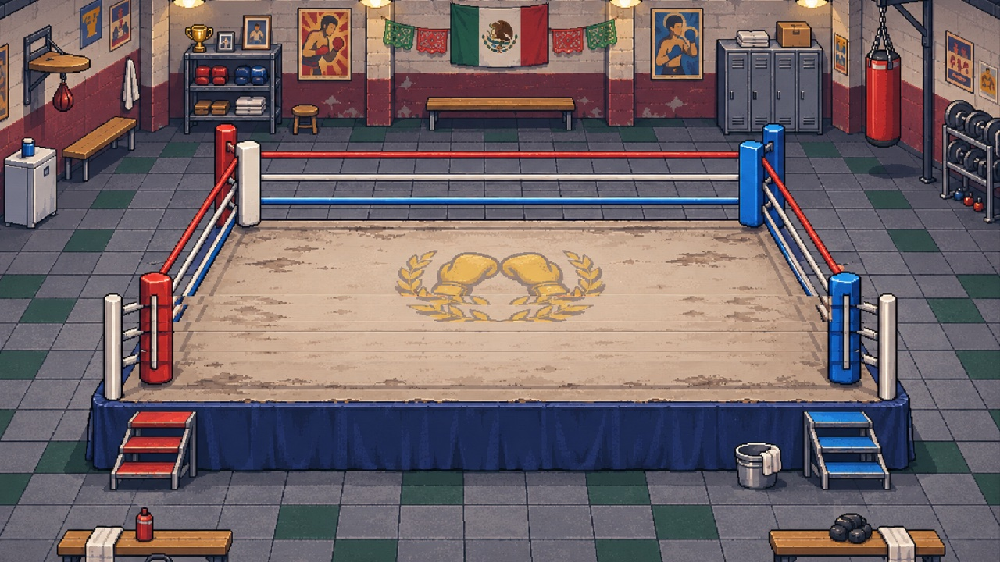 |
| Gimnasio visitante | 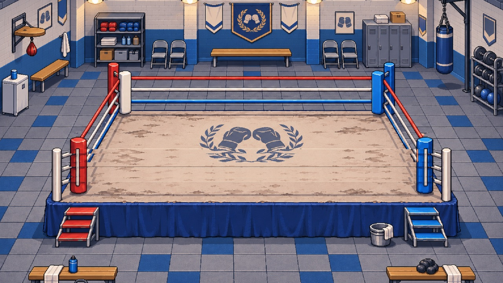 |
| Gimnasio de Box de Mexicali | 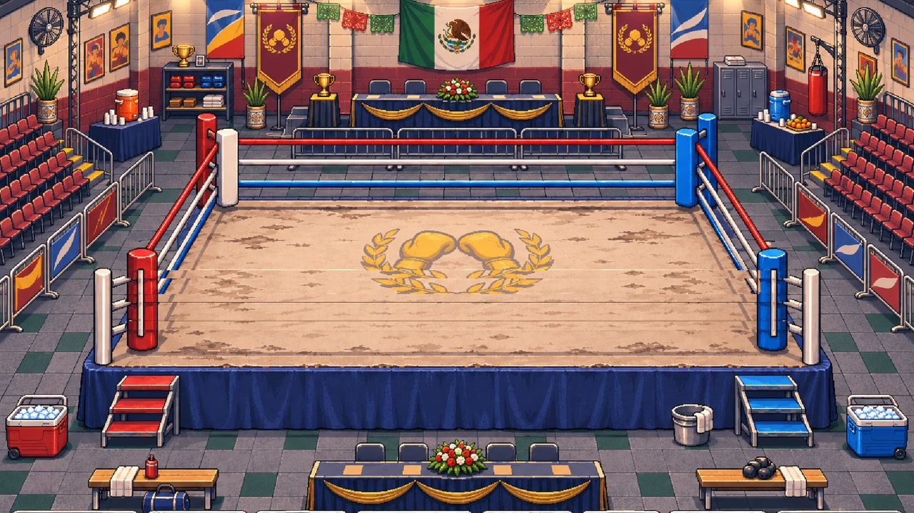 |
| Circuito atlético de Rosarito | 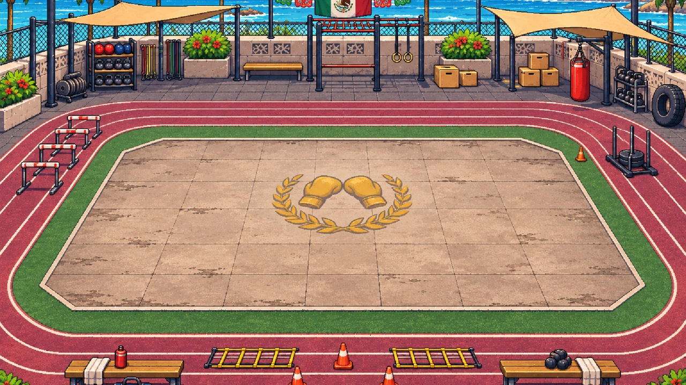 |
| Playa de Rosarito (tira lateral) | 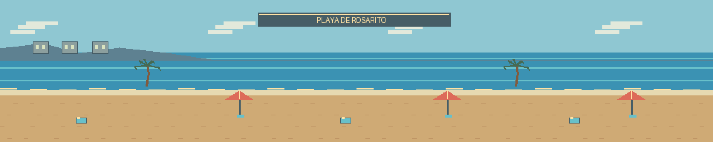 |

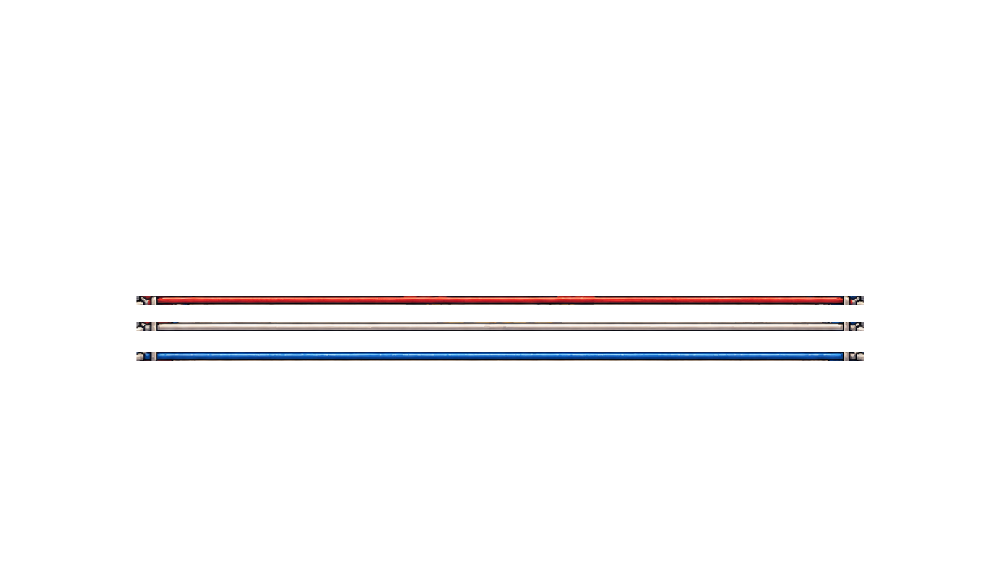

*Figura 5.1. Capa de primer plano con las cuerdas frontales del ring; se dibuja sobre los boxeadores para dar profundidad.*

### 5.3 Tiles

Los tiles son isométricos de **64 × 48 px** (huella de 64 × 32 px) y se empacan en un atlas de 8 × 4 celdas. Se usan para la zona isométrica del muelle de Rosarito y como base de diseño de los mapas de cada escenario.

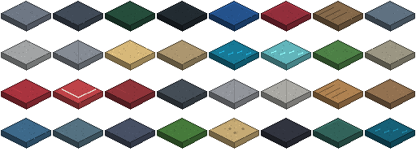

*Figura 5.2. Atlas isométrico de 32 tiles (índices 0 a 31).*

| Índice | Tile | Índice | Tile | Índice | Tile | Índice | Tile |
|:-:|:-:|:-:|:-:|:-:|:-:|:-:|:-:|
| 0 concreto | 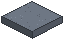 | 8 skate | 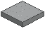 | 16 pista roja |  | 24 piso azul | 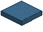 |
| 1 sombra | 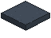 | 9 skate rayas | 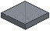 | 17 pista líneas | 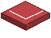 | 25 pintado | 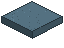 |
| 2 gym verde | 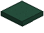 | 10 arena | 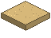 | 18 pista oscura | 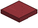 | 26 gradas | 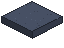 |
| 3 gym negro | 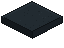 | 11 arena húmeda | 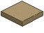 | 19 asfalto | 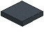 | 27 seto | 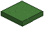 |
| 4 ring azul | 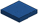 | 12 mar |  | 20 piso gris | 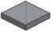 | 28 huellas | 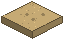 |
| 5 ring rojo | 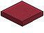 | 13 espuma | 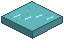 | 21 baldosa | 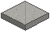 | 29 piso negro | 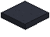 |
| 6 madera |  | 14 pasto |  | 22 muelle |  | 30 colchoneta |  |
| 7 metal |  | 15 sendero |  | 23 tierra |  | 31 mar profundo |  |


*Figura 5.3. Tiles modulares de cuerdas (roja, blanca y azul) de 128 × 14 px.*


*Figura 5.4. Maquetas isométricas construidas con el atlas de tiles; sirvieron como planos de diseño de cada escenario.*

### 5.4 Objetos de escenario (props)

Los props son PNG con transparencia que se colocan sobre el decorado y se ordenan por profundidad junto con los personajes. Varios son además obstáculos de la carrera.

| | | | | | |
|:-:|:-:|:-:|:-:|:-:|:-:|
| <br>costal | <br>lockers | <br>pesas | <br>banca | <br>silla | <br>gradas |
| <br>cartel Sanchez | <br>cartel Mexicali | <br>bandera | <br>banderola | <br>valla | <br>cono |
| <br>caja de madera | <br>bote de basura | <br>fuente de agua | <br>sombrilla | <br>tabla de surf | <br>torre salvavidas |
| <br>árbol | <br>arbusto | <br>maceta | <br>poste de luz | <br>barandal | <br>escaleras |

### 5.5 Ítems y elementos provisionales

| Botella | Isotónica | Plátano | Toalla | Manoplas | Cuerda |
|:-:|:-:|:-:|:-:|:-:|:-:|
|  |  |  |  |  |  |

| Indicaciones de golpe | Ola | Perro | Cangrejo | Pelota |
|:-:|:-:|:-:|:-:|:-:|
|  |  |  |  |  |


*Figura 5.5. Viñeta que oscurece los bordes de la pantalla cuando la concentración baja de 40.*

### 5.6 Cinemáticas

Las cinemáticas son secuencias de líneas de diálogo sin voces. Cada línea define **orador, emoción, fondo, texto y lado**. El fondo es el decorado del escenario correspondiente o una pantalla negra; el texto aparece letra por letra en un cuadro inferior. Cuando habla un personaje, el cuadro muestra su nombre y su **rostro de diálogo**, cuya boca se abre y se cierra cada 0.12 s mientras se escribe el texto; las líneas del narrador van sin rostro. `J` avanza y `Esc` salta la cinemática. Los recorridos usan el mismo cuadro para los diálogos de Carlos.

| Narrador | Personaje con rostro |
|:-:|:-:|
|  |  |

---

## 6. Música y sonidos

### 6.1 Música

La banda sonora es trap latino interpretado en formato chiptune de 8 bits. Cada escena declara su pista y la música se reproduce en bucle a volumen 45 %.

| Pista | Uso |
|---|---|
| `musica_menu` | Pantalla de título, cinemáticas y resultados |
| `musica_gym` | Sanchez Boxing GYM (ritmo medio para entrenar) |
| `musica_cuerda` | Estación de cuerda (marca el pulso de 0.5 s) |
| `musica_playa` | Carreras: playa de Rosarito y circuito (más rápida y alegre) |
| `musica_pelea` | Todas las peleas (más intensa) |
| `publico` | Ambiente del pasillo de Mexicali |

### 6.2 Efectos de sonido

Los efectos responden a **eventos del combate** mediante un sistema observador: el combate emite el evento y el audio, el HUD y el público reaccionan.

| Evento | Efecto |
|---|---|
| Golpe conectado | `golpe_suave` |
| Golpe fuerte (gancho/uppercut a la cabeza, combo o ≥ 8 de daño) | `golpe_fuerte` + reacción del `publico` |
| Bloqueo | `bloqueo` |
| Caída | `caida` |
| Inicio o fin de round | `campana` |
| Ítem, menú o estación | `menu` |

Los archivos de audio son provisionales (WAV); si falta alguno, el juego lo registra en consola y continúa sin sonido.

---

## 7. Interfaz de usuario

### 7.1 Pantalla de título

Menú con cuatro opciones: **Demo (3 niveles)**, **Historia completa**, **Controles** y **Volver al lanzador**. El fondo es el decorado del Sanchez Boxing GYM oscurecido. Se navega con `W`/`S` y se acepta con `J` o `Enter`.

### 7.2 HUD de combate


- **Banda superior:** retrato animado y cuatro barras por boxeador —**RES** (rojo), **AIRE** (azul), **SED** (naranja) y **CONC** (amarillo)—; Diego a la izquierda y el rival a la derecha, en espejo. Al centro, **ROUND n/total** y el reloj.
- **Banda inferior:** nombres de los boxeadores y recordatorio de controles.
- **Retratos reactivos:** cambian a *sorprendido* al recibir golpe, *sonriendo* tras un combo, *cansado* con poco aire, *decidido* con concentración al máximo y *celebrando* al ganar.
- **Señales de concentración:** con concentración alta aparece un destello antes de cada golpe del rival; con concentración baja el rival se ve borroso (dos copias desplazadas) y una viñeta oscurece los bordes.
- **Consejo de Carlos:** durante 10 s se muestra el próximo golpe del rival.

### 7.3 HUD de recorrido y carrera

- **Recorridos (gimnasio, pasillo):** barras de Diego, contador de estaciones completadas, avisos de Carlos y textos de cada minijuego.
- **Carreras:** barras de **AIRE** y **SED**, tiempo restante, tramo actual y metros a la meta (playa) o vuelta actual (circuito), y recordatorio de controles.


### 7.4 Menú de pausa

`Esc` abre la pausa en recorridos, carreras y peleas: **Continuar**, **Reiniciar nivel** y **Menú principal**. Cada opción es un comando independiente.

### 7.5 Pantallas de fase de pelea

| Presentación | Esquina | Decisión |
|:-:|:-:|:-:|
|  |  |  |

- **Presentación:** «ROUND n» y «Diego vs Rival».
- **Esquina:** 10 s para elegir agua (`J`) o consejo (`K`).
- **Caída:** número del conteo en grande y barra de pulsaciones para levantarse.
- **Decisión:** tarjetas de los tres jueces; en Mexicali se levantan sobre la mesa de jueces pintada.
- **Fin:** «¡VICTORIA!», «¡AGUANTASTE!», «DERROTA» o «Ricardo fue demasiado», con la forma del resultado.

### 7.6 Pantalla de resultados

Al terminar cada nivel se muestra un resumen (rival y resultado, o tiempo sobrante en la carrera), la tabla de atributos **antes → ahora** con la diferencia resaltada y las **habilidades nuevas** desbloqueadas.

---

## 8. Controles

El juego se controla solo con teclado. Las acciones tienen nombre y cada escena las enlaza a su lógica (sostener una tecla no cuenta como pulsarla de nuevo).

### 8.1 Combate

| Acción | Tecla |
|---|---|
| Moverse / cambiar de carril | `W` `A` `S` `D` |
| Jab (1) | `J` |
| Recto (2) | `K` |
| Gancho (3) | `L` |
| Uppercut (4) | `I` |
| Guardia | `Shift` (mantener) |
| Esquiva lateral | `Q` / `E` |
| Agacharse | `Q` + `E` juntas |
| Levantarse en el conteo | `J` y `K` alternadas |
| Esquina | `J` agua · `K` consejo |
| Pausa | `Esc` |
| Lanzador de juegos | `F1` |

### 8.2 Carrera (playa y circuito)

| Acción | Tecla |
|---|---|
| Acelerar | `D` |
| Frenar | `A` |
| Saltar | `W` |
| Agacharse | `S` |
| Romper caja o bote | `J` `K` `L` `I` |

### 8.3 Combinaciones

Las combinaciones se ejecutan presionando los golpes en secuencia con **menos de 0.45 s** entre cada uno.

| Combinación | Secuencia | Requisito |
|---|---|---|
| Doble jab y recto | 1-1-2 (`J J K`) | Aprendida en las manoplas |
| Jab, recto y gancho | 1-2-3 (`J K L`) | Aprendida en las manoplas |
| Gancho y uppercut | 3-4 (`L I`) | Aprendida en las manoplas |
| «Frontera» | 1-2-3-4 (`J K L I`) | Concentración al 100 % y habilidad desbloqueada |

---

## 9. Progresión

### 9.1 Secuencia del demo

El demo resume la primera parte de la historia en tres niveles: **aprender, entrenar y competir**.

```
Prólogo → Sanchez Boxing GYM (estaciones) → Sparring vs Brandon → Resultados
→ Intro playa → Playa de Rosarito → Resultados
→ Llegada a Mexicali → Pasillo → Pelea vs Javier → Resultados
→ «Ricardo observa» → Fin del demo
```

### 9.2 Secuencia de la historia completa

| # | Capítulo | Pasos |
|:-:|---|---|
| 1 | Prólogo | Cinemática → gimnasio (estaciones) → resultados |
| 2 | Capítulo 1 | Cinemática → playa → circuito → sparring con niños → resultados |
| 3 | Capítulo 2 | Cinemática → sparring vs Brandon → torneo local 1 → torneo local 2 → resultados |
| 4 | Capítulo 3 | Cinemática → pasillo de Mexicali → vs Javier → vs Kevin → resultados |
| 5 | Capítulo 4 | Cinemática → semifinal vs Ricardo (derrota obligatoria) → epílogo |
| 6 | Segunda mitad | Cinemática → playa (difícil) → circuito (difícil) → revancha vs Javier → revancha vs Kevin → resultados |
| 7 | Final | Cinemática → final vs Ricardo (12 rounds) → créditos |

### 9.3 Mejoras de atributos

| Origen | Mejora |
|---|---|
| Costal completado | Poder +1 |
| Manoplas completadas | Velocidad +1 y combinaciones |
| Cuerda completada | Aire +1 |
| Playa con ≥ 1/3 del tiempo sobrante | Aire +2, resistencia +1 |
| Playa con menos tiempo sobrante | Aire +1 |
| Circuito con todas las vueltas bajo 26 s | Velocidad +1 |
| Sparring vs Brandon superado | Defensa +1, concentración +1 |

Al cerrar cada pantalla de resultados, los atributos actuales se vuelven la nueva línea base.

---

## 10. Niveles y entornos

### 10.1 Resumen

| Nivel | Escenario | Tipo | Objetivo | Duración |
|:-:|---|---|---|---|
| 1 | Sanchez Boxing GYM (Tijuana) | Recorrido con estaciones + sparring | Completar costal, manoplas y cuerda; aguantar 3 rounds contra Brandon | 6–8 min |
| 2 | Playa de Rosarito | Carrera de resistencia | Llegar al muelle antes del límite sin quedarse sin aire | 1–2 min |
| 3 | Gimnasio de Box de Mexicali | Pasillo + pelea de torneo | Ganar a Javier por nocaut o decisión en 3 rounds | 4–6 min |
| — | Circuito atlético de Rosarito | Carrera por vueltas | 3 vueltas al óvalo antes del límite | 1–2 min |
| — | Gimnasio visitante | Pelea de torneo local | Ganar a un rival sorteado en 2 rounds | 2–3 min |

### 10.2 Nivel 1 — Sanchez Boxing GYM

Es el gimnasio de toda la vida del barrio: paredes rojas y crema llenas de pósters, papel picado y bandera de México, focos colgantes, piso de mosaico verde y gris y el ring al centro como pieza principal. Carlos siempre anda cerca con su cronómetro.


**Estructura.** Todo el gimnasio cabe en una pantalla. Diego camina libremente por el piso; las estaciones están marcadas sobre el decorado con un número:

| Estación | Posición | Acción |
|---|---|---|
| Garrafón de agua | Izquierda | Sed a cero (repetible) |
| Plátano (casilleros) | Fondo | Resistencia máxima ×1.25 |
| Costal | Derecha | Minijuego de indicaciones |
| Cuerda | Frente | Minijuego de pulso musical |
| Manoplas | Frente derecha | Minijuego de memoria y ritmo |
| Escalera roja | Esquina izquierda | Subir al ring (solo con las 3 estaciones completas) |


**Colisiones.** El piso transitable es un polígono que sigue el perímetro pintado; los muebles y la caja del ring (ring + faldón) son rectángulos que no se cruzan caminando. Cada estación se activa a menos de 110 px.

**Sparring.** Al subir por la escalera empieza el sparring de 3 rounds contra Brandon. No es necesario ganar: basta seguir de pie al final.

### 10.3 Nivel 2 — Playa de Rosarito

Es fin de semana y Diego sale a correr por la arena rumbo al muelle, con el mar a un lado y un letrero de «Playa de Rosarito» sobre el horizonte.


**Estructura.** Carrera lateral de **1100 px de arte** (≈ 137 m en pantalla) dividida en tres tramos de un tercio:

| Tramo | Terreno | Obstáculos |
|---|---|---|
| 1 — Arena seca | Velocidad normal | Pocos obstáculos (cada ~300 px): conos, bancas, banderolas, cajas |
| 2 — Orilla del mar | Arena mojada: velocidad ×0.8; olas cada 6 s | Obstáculos cada ~220 px |
| 3 — Rumbo al muelle | Velocidad normal | Obstáculos cada ~150 px; 50 % son perros, cangrejos o pelotas que se mueven hacia Diego |

Entre tramos hay **puestos de agua** (sed a cero y punto de control). Hay una zona de sombra de sombrilla y plátanos e isotónicas en el camino. Los obstáculos se generan con **semilla fija**: el nivel es idéntico en cada intento.

**Meta: el muelle.** Al cruzar la meta, la cámara cambia a una **zona isométrica** construida con tiles (muelle de madera, mar y arena) donde Diego camina hasta Carlos.


### 10.4 Circuito atlético de Rosarito

Pista ovalada roja alrededor de una plancha central con el emblema de los guantes, junto al mar. Diego recorre la línea central del óvalo.


- **3 vueltas** de 1500 px (4500 px en total).
- Cada vuelta: 4 vallas (se saltan), 2 conos (se rompen o saltan) y 1 banderola (se pasa agachado).
- Al completar cada vuelta: agua y punto de control.
- Bono de velocidad si **todas** las vueltas duran 26 s o menos.

### 10.5 Gimnasio visitante

Gimnasio azul y blanco con gradas, lockers, costal y fuente de agua. Sede de los torneos locales del capítulo 2.


### 10.6 Nivel 3 — Gimnasio de Box de Mexicali

Seis meses después, Diego llega al torneo más importante de la región. El gimnasio es mucho más grande que el de Sánchez: gradas rojas a ambos lados, banderas de México y Estados Unidos, estandartes del torneo, trofeos, hieleras en las esquinas y la mesa de jueces al frente.

**Parte 1 — Pasillo.** Diego entra junto a Carlos. Al pasar por dos puntos se disparan diálogos: el vendaje de manos y las instrucciones finales. Javier espera en la esquina contraria. Se sube al ring por la escalera roja.


**Parte 2 — Ring del torneo.** Pelea de 3 rounds de 60 s con jueces contra Javier.


**Colisiones del ring.** La lona es un polígono trapezoidal (perspectiva 3/4) que limita el movimiento; las cuerdas funcionan como paredes. Diego tiene su esquina a la izquierda y el rival a la derecha; Carlos espera junto a la escalera.

---

## 11. Gameplay

### 11.1 Ciclo principal

```
Cinemática → Recorrido / Carrera (entrenar, mejorar atributos)
           → Pelea (administrar el cuerpo, aplicar lo aprendido)
           → Resultados (ver la mejora) → siguiente capítulo
```

### 11.2 Ciclo de una pelea

```
Presentación (2 s) → Round (60 s) ─┬─ caída → Conteo ─┬─ se levanta → Round
                                   │                  └─ no se levanta → Nocaut
                                   ├─ 3 caídas de Diego en el round → Nocaut técnico
                                   └─ campana ─┬─ quedan rounds → Esquina (10 s) → Presentación
                                               └─ último round → Decisión de jueces → Fin
```

Cada fase es un estado independiente que decide cuándo pasa a la siguiente.

### 11.3 Ciclo de una carrera

Correr → administrar el ritmo (aire) → saltar, agacharse o romper obstáculos → beber en los puestos (sed y punto de control) → llegar a la meta. Si el aire o el tiempo llegan a cero, Diego reaparece en el último puesto con aire lleno, sed en cero y al menos 60 s.

---

## 12. Metas

### 12.1 Meta del demo

Llevar a Diego desde su primer día en el gimnasio hasta su primera victoria en «Guerra en la Frontera».

| Nivel | Condición de éxito | Condición de fallo |
|---|---|---|
| 1 — Gimnasio | Completar las 3 estaciones y seguir de pie tras 3 rounds con Brandon | Nocaut o nocaut técnico: la pelea se repite |
| 2 — Playa | Llegar al muelle en ≤ 45 s | Aire o tiempo en cero: reaparece en el último puesto de agua |
| 3 — Mexicali | Ganar a Javier por nocaut o decisión | Perder: la pelea se repite desde el inicio |

Al ganar, una cinemática muestra a Ricardo Oropeza observando a Diego desde las gradas como adelanto del juego completo.

### 12.2 Meta de la historia completa

Coronarse campeón de «Guerra en la Frontera» venciendo a Ricardo Oropeza en la final de 12 rounds.

### 12.3 Tipos de objetivo de pelea

| Objetivo | Se avanza cuando |
|---|---|
| **Sobrevivir** | Diego sigue de pie al final (sparring con Brandon). |
| **Ganar** | Diego gana por nocaut o decisión. |
| **Perder forzado** | Siempre: nadie puede quedar noqueado (resistencia mínima 1) y la decisión es unánime para el rival (semifinal). |

---

## 13. Mecánicas

### 13.1 Barras físicas

| Barra | Inicio | Sube / baja |
|---|---|---|
| Resistencia | `40 + 8 × resistencia` | Baja con cada golpe recibido; en cero, caída. Entre rounds recupera 12 % del máximo. |
| Aire (0–100) | 100 | Baja al golpear y esquivar. Se recupera `8 + 1.2 × aire` por segundo: ×1.5 con guardia, ×0.7 al moverse y ×0.5 si la sed supera 70. Se llena entre rounds. |
| Sed (0–100) | 0 | Sube `0.5 × f` por segundo y `0.6 × f` por golpe, con `f = 1.5 − 0.1 × sed`. Solo baja con agua. |
| Concentración (0–100) | `50 + 5 × concentración` | Baja con golpes a la cabeza no bloqueados (`14 − concentración`), al recibir el cierre de un combo (−10) y con aire menor a 20 (−2/s). Sube con guardia (+2/s). |

### 13.2 Golpes

| Golpe | Tecla | Aire base | Daño base |
|---|:-:|:-:|:-:|
| Jab | `J` | 5 | 3 |
| Recto | `K` | 7 | 5 |
| Gancho | `L` | 11 | 8 |
| Uppercut | `I` | 12 | 9 |

- **Costo de aire** = aire base × `(1.3 − 0.05 × aire)`. Si no alcanza el aire, el golpe sale sin fuerza.
- **Esquiva** = 6 × `(1.3 − 0.05 × aire)`.
- Con aire menor a 25, las animaciones son 30 % más lentas.

### 13.3 Cálculo del daño

El daño se calcula con una cadena de modificadores que envuelven al anterior:

```
base → poco aire → bloqueo → combo → contragolpe → «Frontera»
```

| Modificador | Condición | Efecto |
|---|---|---|
| Base | Siempre | daño base × `(0.5 + 0.1 × poder)` |
| Poco aire | Aire del atacante < 25 | ×0.5 |
| Bloqueo | Defensor con guardia | ×`(1 − 0.07 × defensa)` |
| Combo | El golpe cierra una combinación | ×1.25 |
| Contragolpe | Golpe dentro de 0.4 s tras una esquiva exitosa | ×2 |
| «Frontera» | Combinación especial | ×2 |
| Agachado | Defensor agachado | Jab, recto y gancho fallan; el uppercut entra ×1.5 |

**Ejemplo.** Un gancho de Diego (poder 8) sin modificadores hace `8 × 1.3 = 10.4` de daño. Bloqueado por Ricardo (defensa 9) hace `10.4 × 0.37 ≈ 3.8`.

Solo los golpes fuertes (gancho, uppercut, combos y contragolpes) sobre un rival sin guardia lo dejan **aturdido**; una ráfaga de jabs no lo paraliza.

### 13.4 «Frontera»

Requiere la habilidad desbloqueada y la concentración al 100 %. Con la secuencia 1-2-3-4 cada golpe hace doble daño; si **los cuatro conectan seguidos**, el rival cae a la lona. En la semifinal no puede derribar a Ricardo.

### 13.5 Caída y conteo

- El conteo avanza un número por segundo hasta 10.
- **Diego** se levanta con pulsaciones **alternadas** de `J` y `K`: 10 la primera vez y 6 más por cada caída previa en la pelea. Se levanta con 40 % de resistencia.
- **El rival** se levanta con probabilidad `resistencia / 12 − 0.2 × caídas previas` (entre 0 y 0.95), en un número entre 6 y 8.
- Tres caídas de Diego en un mismo round = **nocaut técnico**.
- Mientras dura el conteo, el boxeador de pie va a la esquina neutral y deja de golpear.

### 13.6 Esquina

Al sonar la campana: aire lleno, +12 % de resistencia para ambos, el rival baja 30 de sed y la **toalla** sube la concentración de Diego a 60 como mínimo. En 10 s el jugador elige **una** opción:

- `J` — **Tomar agua:** la sed baja a cero.
- `K` — **Escuchar a Carlos:** concentración +30 y, durante 10 s del siguiente round, el HUD muestra el próximo golpe del rival.


### 13.7 Decisión de los jueces

Tres jueces puntúan cada round con el sistema de 10 puntos. Para cada boxeador calculan:

```
puntaje = golpes conectados + daño / 10 + 3 × caídas del rival + ruido(−1, 1)
```

El ganador del round recibe 10 y el perdedor 9 (8 si cayó). El resultado es **unánime** (3 jueces), **dividido** (2 jueces) o **empate**.


### 13.8 Minijuegos del gimnasio

| Estación | Regla | Éxito |
|---|---|---|
| **Costal** | Aparece la tecla a presionar (5 de cada golpe: `J`, `K`, `L`, `I`). Si pasan 1.5 s, Carlos pide «¡Más rápido!». | 20 aciertos |
| **Manoplas** | Carlos demuestra una combinación (0.5 s por golpe) y Diego la repite: 3 s para empezar y 0.6 s entre teclas. Un error o lentitud reinicia la secuencia. | Repetir 1-1-2, 1-2-3 y 3-4 dos veces cada una |
| **Cuerda** | Presionar `J` en el pulso de la música (cada 0.5 s, tolerancia ±0.12 s) durante 16 s. | 22 de 32 pulsos; si no, se repite |

### 13.9 Física de la carrera

| Parámetro | Valor |
|---|---|
| Velocidad (frenar / normal / acelerar) | 40 / 60 / 85 px/s |
| Arena mojada | ×0.8 |
| Aire por segundo (acelerar / normal / frenar) | −6 / +1 / +4 |
| Sombra | +8 aire/s |
| Sed | +0.8/s; con sed > 70 la recuperación de aire se reduce a la mitad |
| Salto | Impulso de 160 px/s, gravedad 420 px/s² |
| Choque con obstáculo | Velocidad 30 px/s durante 1 s, −10 aire, 1 s de invulnerabilidad |
| Ola | Velocidad ×0.5 durante 1.5 s, −8 aire (se evita saltando) |
| Romper caja | −4 aire |

| Obstáculo | Tipo | Cómo superarlo |
|---|---|---|
| Cono, banca, valla, perro, cangrejo, pelota | Bajo | Saltar |
| Banderola | Alto | Agacharse |
| Caja de madera, bote de basura | Rompible | Golpear a ≤ 30 px o saltar |

### 13.10 Inteligencia artificial de los rivales

Un **cerebro** por rival decide en cada momento entre acercarse a su distancia ideal, cubrirse, esquivar o golpear según su estilo (sección 2.6). Escribe en el mismo control que usa el jugador, por lo que el rival obedece exactamente las mismas reglas de aire, golpes y animaciones que Diego. Los rivales agresivos golpean avanzando; los demás se plantan. Contra golpes a la cabeza, a veces se agachan, lo que el uppercut castiga.

### 13.11 Movimiento en el ring

El ring se representa en perspectiva 3/4: `A`/`D` mueven a lo ancho y `W`/`S` cambian la profundidad (carril). Los boxeadores se dibujan ordenados por profundidad y se miran automáticamente. Un golpe solo conecta si el rival está al alcance de ese golpe.

---

## 14. Habilidades

| Habilidad | Uso | Desbloqueo | Efecto |
|---|---|---|---|
| Jab, recto, gancho, uppercut | `J` `K` `L` `I` | Desde el inicio | Golpes básicos; gancho y uppercut pegan más pero gastan más aire |
| Guardia | `Shift` | Desde el inicio | Reduce el daño, acelera el aire ×1.5 y sube la concentración |
| Agacharse | `Q` + `E` | Desde el inicio | Evita jab, recto y gancho; vulnerable al uppercut |
| Combinaciones 1-1-2, 1-2-3, 3-4 | Secuencia | Manoplas (nivel 1) | ×1.25 de daño y −10 de concentración al rival |
| Esquiva lateral | `Q` / `E` | Inicio del sparring con Brandon | Evita un golpe y abre la ventana de contragolpe |
| Contragolpe | Golpe ≤ 0.4 s tras esquivar | Al superar el sparring con Brandon | ×2 de daño |
| Segundo aire | Automático | Al terminar la playa | Una vez por pelea, con aire < 10, recupera 50 |
| Combinación «Frontera» | 1-2-3-4 con concentración al 100 % | Pelea contra Javier | ×2 de daño por golpe; si conectan los 4, derriba |

---

## 15. Ítems y power-ups

| Ítem | Dónde | Efecto |
|---|---|---|
|  Agua del garrafón | Gimnasio | Sed a cero (repetible) |
|  Agua en la esquina | Entre rounds (opción `J`) | Sed a cero |
|  Puesto de agua | Playa (entre tramos) y circuito (cada vuelta) | Sed a cero y punto de control |
|  Plátano | Casilleros del gimnasio | Resistencia máxima ×1.25 en el recorrido |
|  Plátano | Playa (al 13 % y 58 % del recorrido) | +20 de aire |
|  Bebida isotónica | Playa, sobre algunas cajas (hay que saltar) | +30 de aire y −40 de sed |
|  Sombra de sombrilla | Playa | +8 de aire por segundo mientras se cruza |
|  Toalla | Esquina, automática | Concentración mínima de 60 (quita el oscurecimiento) |
| Consejo del entrenador | Esquina (opción `K`) | +30 de concentración y muestra el siguiente ataque del rival durante 10 s |

---

## 16. Dificultad

La dificultad crece por **rival**, por **número de rounds** y por **tiempo disponible**.

| Pelea | Rival | Rounds × s | Jueces | Ajuste |
|---|---|:-:|:-:|---|
| Sparring con niños | Niño del barrio | 1 × 60 | No | Atributos 3 |
| Sparring | Brandon | 3 × 60 | No | Solo sobrevivir |
| Torneo local 1 y 2 | Niño del barrio | 2 × 60 | Sí | Atributos sorteados entre 4 y 6 |
| Torneo | Javier | 3 × 60 | Sí | — |
| Torneo | Kevin | 3 × 60 | Sí | — |
| Semifinal | Ricardo | 3 × 60 | Sí | Derrota obligatoria |
| Revancha | Javier | 3 × 60 | Sí | Atributos +1 |
| Revancha | Kevin | 3 × 60 | Sí | Atributos +1 |
| Final | Ricardo | **12 × 45** | Sí | Ricardo ya es el más fuerte; se deja sin bono para que la final sea exigente pero justa |

| Carrera | Meta | Límite |
|---|---|---|
| Playa | 1100 px (~20 s a ritmo normal) | 45 s |
| Playa (segunda mitad) | 1100 px | 35 s |
| Circuito | 3 vueltas (4500 px) | 100 s |
| Circuito (segunda mitad) | 3 vueltas | 85 s |

La curva busca que el jugador **pierda pocas veces** en el demo: el sparring solo exige aguantar, la playa tiene margen amplio y Javier se cansa rápido.

---

## 17. Accesibilidad

**Implementado:**

- Sin dependencia del audio: todos los diálogos, avisos y consejos son texto en pantalla.
- Barras con **color y etiqueta** (RES, AIRE, SED, CONC), de modo que no dependen solo del color.
- Pausa disponible en cualquier recorrido, carrera o pelea, con reinicio del nivel.
- Reintentos ilimitados y sin penalización; la carrera reaparece en el último punto de control con al menos 60 s.
- Cinemáticas que se pueden saltar con `Esc`.
- Controles recordados en la banda inferior de cada escena y en el menú **Controles**.
- Sostener una tecla no repite la acción (evita pulsaciones accidentales en menús y minijuegos).

**Pendiente:** reasignación de teclas, soporte de control, modo para daltonismo, control de volumen y ajuste de velocidad del texto.

---

## 18. Marketing

- **Gancho:** «Un juego de box retro hecho en Baja California: entrena, pelea y aprende a perder para llegar al round 12».
- **Material:** tráiler corto con las capturas de este documento, GIFs de combos y de la «Frontera», y el demo descargable.
- **Canales:** itch.io (demo gratuito), redes de la facultad, comunidades de videojuegos independientes de Baja California y gimnasios de box de la región.
- **Diferenciador:** escenarios reales y reconocibles de Tijuana, Rosarito y Mexicali, y un sistema de estadísticas físicas poco común en juegos de box arcade.

---

## 19. Audiencia

- **Principal:** jugadores casuales de todas las edades que buscan partidas cortas, controles fáciles de aprender y combates entretenidos.
- **Secundaria:** jugadores mid-core y aficionados al boxeo que quieran dominar el manejo de barras, combos y contragolpes.
- **Regional:** público de Baja California que reconoce los lugares representados.
- **Nostálgica:** jugadores veteranos interesados en la estética de los años 80.

---

## 20. Plataformas y requisitos técnicos

| Componente | Mínimo estimado |
|---|---|
| Sistema operativo | Windows, Linux o macOS |
| Procesador | x86-64 o ARM (Apple Silicon) |
| Memoria RAM | 2 GB |
| Gráficos | Integrados (no requiere GPU dedicada) |
| Almacenamiento | 200 MB |
| Entrada | Teclado |
| Rendimiento objetivo | 60 cuadros por segundo a 1080 × 720 |

---

## 21. Monetización

ROUND 12 es un proyecto académico y se distribuye **gratuitamente**. No contiene compras dentro del juego, anuncios ni recolección de datos. Si el proyecto continuara fuera del curso, el modelo propuesto es **pago único** por la historia completa con el demo gratuito como muestra.

---

## 22. Arquitectura técnica

### 22.1 Motor

ROUND 12 corre sobre **CimaEngine3v**, el motor desarrollado durante el curso.

| Elemento | Tecnología |
|---|---|
| Lenguaje | C++17 |
| Gráficos, ventana, audio y entrada | SFML 3.0 |
| Herramientas de depuración | Dear ImGui 1.91.9 (rama *docking*) |
| Compilación | CMake con Ninja Multi-Config (Debug / Release) |
| Ejecutable | `bin/<perfil>/CimaEngine3v` |

El ejecutable arranca un **lanzador** que permite elegir entre *CimaEngine Labs* (las prácticas del curso) y *ROUND 12*; `F1` regresa al lanzador desde el juego. El motor aporta el gestor de escenas, el gestor de assets (texturas, música y sonidos), cámaras, el búfer de entrada con acciones con nombre, entidades con componentes y máquinas de estados, y un editor ImGui con vista del juego, lista de objetos, propiedades, registro y escenas.

### 22.2 Estructura del código (`src/Round12/`)

| Carpeta | Contenido |
|---|---|
| `JuegoR12` | Capa de juego: registra escenas, despacha teclas, maneja la pausa |
| `Escenas/` | Título, cinemática, recorrido, ring, carrera y resultados |
| `Logica/` | Reglas puras sin gráficos: estadísticas, combate, daño, combos, conteo, jueces, IA, carrera, colisiones, partida e historia |
| `Maquinas/` | Fases de la pelea, nodos de estado del boxeador y cerebro del rival |
| `Datos/` | Perfiles, niveles, escenarios, diálogos (`dialogos/*.txt`) y mapa isométrico del muelle |
| `objetos/` | Audio, HUD, caja de diálogo, fábrica de entidades, lista de dibujo, isométrico y viñeta |
| `Sistemas/` | Sistemas de alcance de golpes, orientación (mirarse), separación de cuerpos y caminar sobre el piso |
| `pruebas/` | Pruebas de la lógica (`Round12Pruebas`) |

Los assets se leen de `ROUND12_Assets/` en la raíz del repositorio; los diálogos y datos, de `src/Round12/Datos/`.

### 22.3 Datos del juego

- **Historia:** lista ordenada de pasos `{tipo, id}` (cinemática, recorrido, pelea, carrera, resultados, fin). El `id` indexa las tablas de configuración.
- **Peleas:** rival, rounds, segundos por round, objetivo, escenario, jueces, dificultad, tinte, rival aleatorio, habilidades al iniciar/terminar y mejoras.
- **Recorridos:** escenario, estaciones, diálogo inicial, diálogos por punto, música y entrada.
- **Carreras:** meta, tiempo, vueltas, tiempo meta por vuelta, olas y semilla.
- **Diálogos:** un archivo de texto por cinemática con el formato `orador|emoción|fondo|texto[|lado]`.

### 22.4 Patrones de diseño

| Patrón | Aplicación |
|---|---|
| **Singleton** | `Partida` (progreso, atributos y habilidades de Diego) y `Eventos` (bus de eventos). |
| **Observador** | `Eventos`: el combate emite golpes, bloqueos, caídas, campanas e ítems; el audio, el HUD y el público escuchan. |
| **Decorador** | Cadena de modificadores de daño (`ModDanio`): base → poco aire → bloqueo → combo → contragolpe → «Frontera». |
| **Fábrica** | `FabricaR12` crea boxeadores, NPC, sprites de objetos y retratos con sus componentes. |
| **Comando** | Cada tecla es una acción con nombre; cada opción del menú de pausa es un comando. |
| **Adaptador** | `CerebroRival` convierte decisiones de IA en el mismo control del jugador; `Piso` convierte polígonos en reglas de movimiento; `Camino` convierte distancia 1D en un punto del óvalo; `MapaColision` lee capas TXT. |
| **Fachada** | `Combate` reúne barras, golpes, rounds y decisión en una sola interfaz. |
| **Método plantilla** | `EscenaR12` define el ciclo común (cargar, reiniciar, actualizar, dibujar mundo, dibujar pantalla, música) y cada escena implementa sus pasos. |
| **Iterador** | `Historia` recorre los pasos del juego; la cinemática recorre las líneas de diálogo. |
| **Composición** | El HUD es un árbol de widgets (panel, barra, etiqueta, retrato); `ListaDibujo` agrupa todo lo que se dibuja entre decorado y primer plano. |
| **Estado** | Fases de la pelea (presentación, round, caída, esquina, decisión, fin) y nodos de la máquina de estados del boxeador (idle, caminar, guardia, agachado, preparar golpe, golpe, esquiva, aturdido, caído, levantarse). |

### 22.5 Paquete de assets

```
ROUND12_Assets/
├── escenarios/<escenario>/   decorado, primer plano, cuerdas, mapa.json
├── sprites/personajes/<p>/   4 direcciones × 39 acciones × 6 cuadros, retratos, rostros
├── motor/hojas/              hojas empacadas por personaje (1920×3120) y de diálogo
├── tilesets/                 32 tiles isométricos, atlas y cuerdas modulares
├── objetos/                  26 props PNG
├── provisionales/            ítems, efectos y audio WAV provisionales
└── tools (en /tools)         round12_hojas.py empaca y verifica el paquete
```

---

## 23. Pruebas y herramientas de desarrollo

### 23.1 Pruebas de lógica

El objetivo `Round12Pruebas` verifica las reglas sin gráficos: estadísticas, daño, combos, conteo, jueces, carrera, colisiones, secuencias de la historia y existencia de todos los niveles.

```bash
cmake --build build --config Release --target Round12Pruebas
./bin/Release/Round12Pruebas
```

Estado actual: **453 revisiones, 0 fallas**.

### 23.2 Modo de prueba sin teclado

| Argumento | Efecto |
|---|---|
| `--juego=round12` | Abre ROUND 12 directamente |
| `--r12-paso=tipo:id` | Ejecuta un solo paso (`cine`, `recorrido`, `pelea`, `runner`, `resultados`) o la secuencia `demo` / `historia` |
| `--autopiloto` | Diego juega solo (IA propia para pelear, recorrer estaciones y correr) |
| `--rapido=N` | Ejecuta N actualizaciones por cuadro para acelerar la simulación |

```bash
./bin/Release/CimaEngine3v --r12-paso=pelea:javier --autopiloto --rapido=8
```

Las capturas de este documento se tomaron con estas banderas y `screencapture` de macOS sobre la versión Release del branch actual.

---

## 24. Cambios respecto al Avance 4 y pendientes

### 24.1 Cambios implementados

| Avance 4 | Estado actual |
|---|---|
| Resolución base 320 × 180 escalada | Ventana de 1080 × 720 con decorados pintados de 1920 × 1080 |
| Sprites de 4 poses (44 × 52 / 44 × 56) | 39 acciones × 4 direcciones × 6 cuadros de 80 × 80 |
| Gimnasio en recorrido horizontal | Gimnasio completo en una pantalla, estaciones sobre el decorado |
| Ring en vista lateral | Ring en vista 3/4 con profundidad y cuerdas en primer plano |
| Playa de 3 minutos | Playa de ~20 s con límite de 45 s y llegada isométrica al muelle |
| Parque de skate de Santa Fe | **Eliminado** de la historia (el arte se conserva en el paquete) |
| Final contra Ricardo | 12 rounds de 45 s, dificultad base |
| — | Agacharse (`Q` + `E`), retratos con emociones, torneos locales con rival aleatorio |

### 24.2 Pendientes y observaciones

- El diálogo `playa_intro` todavía menciona «tres minutos para llegar al muelle»; el límite real es de 45 s. Corregir el texto.
- La música y los efectos son provisionales; falta la banda sonora chiptune definitiva.
- Los ítems de la carrera (isotónica, plátano, animales) usan sprites provisionales.
- Solo Diego y Carlos tienen rostros de diálogo con boca animada en tres vistas; los demás personajes usan su retrato de 96 × 96 en el cuadro de diálogo.
- Pendientes de accesibilidad listados en la sección 17.

---

## 25. Conclusión

ROUND 12 está definido y jugable de principio a fin. El demo enseña paso a paso: en el Sanchez Boxing GYM se aprenden los golpes y las combinaciones, en la playa de Rosarito se entiende el valor del aire y la sed, y en Mexicali todo se pone en práctica en una pelea de verdad. La historia completa extiende ese aprendizaje hasta la derrota contra Ricardo y la revancha a doce rounds, donde el título del juego cobra sentido.

Las reglas viven en código aislado y probado, los datos de niveles y diálogos están separados de la lógica, y la arquitectura aplica los patrones de diseño del curso donde tienen función real. Lo que sigue es pulir el audio y los sprites provisionales, cerrar los pendientes de accesibilidad y ajustar el balance con pruebas de jugadores.

---

## 26. Referencias

- Cavia. (2005). *Dragon Ball Z: Supersonic Warriors 2* [Videojuego para Nintendo DS]. Bandai.
- Godot Engine. (s.f.). *Usando TileMaps*. Documentación de Godot Engine. https://docs.godotengine.org/es/4.x/tutorials/2d/using_tilemaps.html
- González, D. (2011). *Diseño de videojuegos: da forma a tus sueños*. RA-MA Editorial.
- Marx Toys. (1964). *Rock 'Em Sock 'Em Robots* [Juguete].
- Morikawa, G. (1989). *Hajime no Ippo* [Anime]. Kodansha.
- SFML. (2024). *Simple and Fast Multimedia Library 3.0*. https://www.sfml-dev.org
- Cornut, O. (2024). *Dear ImGui*. https://github.com/ocornut/imgui
- Ureta Armenta, C. A. (2026). *ROUND 12: Presentación de propuesta de videojuego* [Diapositivas]. UABC.
- Ureta Armenta, C. A. (2026). *Avance 4 GDD*. UABC.
- Zamarrón de la Garza, G. O. (2026). *GDD Parte 1: Unidad II* [Material de clase de Introducción a los Videojuegos]. FCQI, UABC.

---

## 27. Anexo: catálogo de recursos

Todas las imágenes de este documento están en `docs/GDD_Round12/imagenes/`:

| Carpeta | Contenido |
|---|---|
| `capturas/` | 19 capturas del juego en ejecución (título, cinemáticas, diálogo, gimnasio, ring, esquina, decisión, playa, muelle, circuito, Mexicali) |
| `personajes/` | Hojas de animación y de animación hablando de los 6 personajes, y muestra de movimientos especiales |
| `retratos/` | Retrato de HUD de cada personaje, 7 emociones de Diego y rostros de diálogo de Diego y Carlos |
| `escenarios/` | Decorados de los 5 escenarios jugables y capa de cuerdas frontales |
| `tiles/` | 32 tiles isométricos, atlas, cuerdas modulares y maquetas isométricas |
| `objetos/` | 24 props de escenario |
| `items/` | Ítems y sprites provisionales de la carrera y los minijuegos |

### Galería de capturas

| | |
|:-:|:-:|
| <br>Pantalla de título | <br>Cinemática del prólogo |
| <br>Diálogo con rostro | <br>Sanchez Boxing GYM |
| <br>Minijuego del costal | <br>Esquina entre rounds |
| <br>Sparring contra Brandon | <br>Playa de Rosarito |
| <br>Llegada al muelle | <br>Circuito atlético |
| <br>Torneo local | <br>Cinemática del capítulo 3 |
| <br>Pasillo de Mexicali | <br>Pelea contra Javier |
| <br>Cinemática del capítulo 4 | <br>Semifinal contra Ricardo |
| <br>Presentación de round | <br>Desgaste en el round 2 |
| <br>Decisión de los jueces | |
